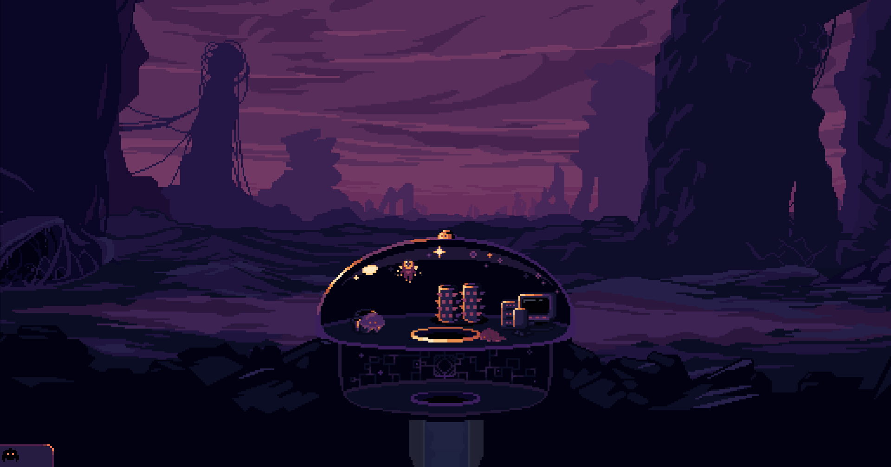
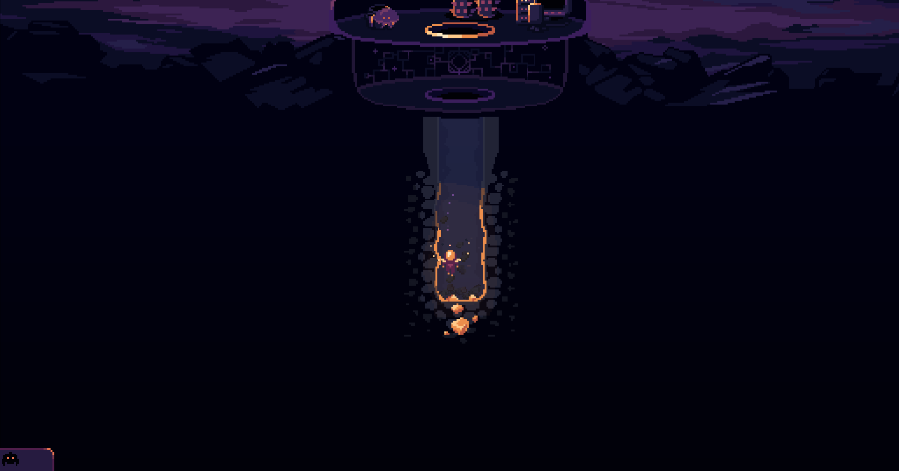

# Driving and observing Dome Keeper for automated playtests

Research for [#7](https://github.com/cejdan/Dome-Keeper-Story-Mode-Mod/issues/7). It feeds [#8 Playtest harness v1](https://github.com/cejdan/Dome-Keeper-Story-Mode-Mod/issues/8).

Question: what is the most reliable way for an agent to drive Dome Keeper and see the result?

Date: 2026-11-10. Engine: the project's custom Godot 4.3.1 editor build (`custom_godot_for_windows/godot.windows.editor.x86_64.exe`). Game: v5.0.8.14, ModLoader 7.0.1.

Each claim is tagged:

- **[verified]**: seen in a spike run of the real game (details under "Spike").
- **[source]**: read in the game source, ModLoader source, or Godot docs. Not run.

## Answer in one table

| Technique | Verdict | Status |
|---|---|---|
| `Input.action_press` / `action_release` | **Does not move the keeper.** It only sets polled action state and sends no event. Gameplay input is event-driven. | verified |
| `Input.parse_input_event(InputEventAction)` | **Does not move the keeper.** `InputProcessor.handle` ignores `InputEventAction`. | verified |
| `Input.parse_input_event(InputEventKey)` built from `InputMap.action_get_events(action)` | **Works.** One press event holds the direction until a release event. This is the technique to use. | verified |
| Screenshot via `get_viewport().get_texture().get_image()` after `await RenderingServer.frame_post_draw` | **Works windowed**, including the Movie Maker run. One shot per rendered frame, so bursts of consecutive frames work. | verified |
| The same in `--headless` | **Fails.** Game logic runs but no frames are drawn, and `frame_post_draw` never fires, so the `await` hangs forever. | verified |
| Movie Maker `--write-movie x.png --fixed-fps 30` | **Works**, but it records the whole run with no start or stop at runtime. Fixed delta, faster than real time. | verified |
| Scenario via `-- --scenario=...`, read with `OS.get_cmdline_user_args()` | **Works**, and it is readable already in the mod's `_init`. | verified |
| Cheats (`Level.stage.cheats._on_*_pressed()`, or the `Data` calls they wrap) | **Works** (add iron verified). Disabling waves via `monster-manager.disabled` was used in every run. The other cheats were only read. | verified / source |
| Fixed map seed via `Level.setSeed(n)` in the mod's `_ready` | **Works and is deterministic.** Same seed gave the same map fingerprint 4 of 4 times, including headless. | verified |
| Fixed seed by restarting the level (`StageManager.startStage("stages/landing/landing", …)`, like the "Load Seed" cheat) | **Flaky.** The right map came up both times, but one of two runs went straight to a "TEAM 2 WON" game-over screen. Avoid. | verified |
| `Engine.time_scale` | **Works.** At 3x, 3 s of game time took 1.04 s of real time, and timers and `GameWorld.runTime` scale with it. | verified |
| Computer use (real mouse and keyboard) | Use it only for what in-process injection cannot cover. See the section near the end. | source |

---

## 1. Input injection

### How the game reads input [source]

- `InputSystem` (autoload) receives every event in `_unhandled_input` and walks a chain of `InputProcessor`s from the deepest leaf upward (`systems/input/InputSystem.gd:155`). Events are routed by `getDeviceIndex(event)`. Keyboard and mouse events use `event.device` (0). Joypad events use `device + 1` (`InputSystem.gd:406`).
- `InputProcessor.handle(event)` dispatches only `InputEventMouseButton`, `InputEventMouseMotion`, `InputEventKey`, `InputEventJoypadButton` and `InputEventJoypadMotion`. Anything else, including `InputEventAction`, returns `false` (`systems/input/InputProcessor.gd:102`).
- `KeeperInputProcessor.buttonEvent` keeps `leftKeyDown`, `rightKeyDown`, `upKeyDown` and `downKeyDown` flags. It sets them on `pressed(event, "ui_*")` and clears them on `released(...)`, then writes `keeper.moveDirectionInput` (`content/keeper/KeeperInputProcessor.gd:155`). Drilling happens by moving into rock, so holding `ui_down` is "drill down". `ui_select` press and release is use/hit, with hold logic in `_process`. `keeper1_pickup` and `keeper1_drop` are handled in `Keeper1InputProcessor.keeperButtonEvent`.
- `tryRestoreInput` re-reads held keys with `Input.is_physical_key_pressed(event.physical_keycode)` when the processor becomes a leaf again, for example after a popup closes (`KeeperInputProcessor.gd:81,117`). An injected key whose `physical_keycode` is set survives that re-read.
- The default bindings in `project.godot` are physical keycodes: `ui_down` is physical Down or S, `ui_select` is physical Space or E, and `cheats` is keycode F1. `Options.loadKeyBindings` replaces them from `user://keybindings_4.cfg` if that file exists (`systems/options/Options.gd:595`, `KEY_BINDINGS` at line 86). Build injected events from `InputMap.action_get_events(action)` rather than hardcoding keys.
- Godot docs: `action_press` "will not cause any Node._input calls", and `parse_input_event` "Also generates Node._input calls" ([Input, 4.3](https://docs.godotengine.org/en/4.3/classes/class_input.html)).

### What the spike saw [verified]

Each method held `ui_down` with the keeper hovering inside the dome. Spawn position is (-22, -49), tile (-1, -6).

| Method | Keeper y before, then after | Notes |
|---|---|---|
| `Input.action_press("ui_down")` for 1.5 s | -49, then -49 | No movement. |
| `parse_input_event(InputEventAction ui_down)` for 1.5 s | -49, then -49 | No movement. |
| `parse_input_event(InputEventKey)` (physical 4194322 = Down) for 3 s | -49, then -18.9 (dome floor) | `Input.is_action_pressed` and `is_physical_key_pressed` were both true mid-hold. |
| Same, `ui_right` for 0.25 s, then `ui_down` for 6 s | x -22 to -7.6, then y -18 to 121.9, tile (0, 2) | The keeper dropped through the dome hatch and drilled into the mine (screenshot below). |

The keeper spawns left of the hatch. Holding down from spawn only lands it on the dome floor. To enter the mine it must first move right about 15 px to the hatch at x ≈ 0. Issue 8's demo ("drill straight down 5 tiles") needs that step.

The injection pattern that works:

```gdscript
func key_event_for(action: String) -> InputEventKey:
    for ev in InputMap.action_get_events(action):
        if ev is InputEventKey:
            return ev.duplicate()
    return null

func hold(action: String, sec: float) -> void:
    var e := key_event_for(action)
    e.pressed = true
    Input.parse_input_event(e)
    await get_tree().create_timer(sec).timeout   # game time: scales with Engine.time_scale
    var r: InputEventKey = e.duplicate()
    r.pressed = false
    Input.parse_input_event(r)
```

### Focus loss eats injected input [source; not triggered in the spike]

- On `NOTIFICATION_APPLICATION_FOCUS_OUT`, `InputSystem` sets `game_not_in_focus = true`. While it is set, `_unhandled_input` returns before dispatching anything (`InputSystem.gd:155,303`). It also calls `onUserTabbedOut()` on the leaf processors, and `KeeperInputProcessor` clears every held key (`KeeperInputProcessor.gd:260`).
- `LevelStage._notification` opens the pause menu on focus out when `Options.pauseWhenOutOfFocus` is set (`stages/level/LevelStage.gd:398`).
- The window had focus in every spike run, so this never fired. An AFK harness can't count on keeping focus. It should set `Options.pauseWhenOutOfFocus = false` and force `InputSystem.game_not_in_focus = false` each frame (or before each injection), and log `DisplayServer.window_is_focused()` alongside its state.

### Other input notes [source]

- Joypad injection is possible but routes to device index `device + 1`, and it flips `Options.setUseGamepad`. Stick to keys for the keyboard keeper (device 0).
- Mouse events are re-mapped into the world and UI SubViewports by `InputSystem._serveSubviewportEvent`, so injected `InputEventMouseButton`s need a real window position. Prefer keys or direct calls for menus.
- `keeperInputStarted` on `Level.stage` turns true when the landing sequence hands control to the player (`LevelStage.gd:905`). Inject only after that.

## 2. Screenshots [verified]

- `await RenderingServer.frame_post_draw` then `get_viewport().get_texture().get_image().save_png(path)` from the mod node captures the composited root viewport, with world and HUD. The Godot docs recommend exactly this await ([Viewport, 4.3](https://docs.godotengine.org/en/4.3/classes/class_viewport.html)). The game's own F-key screenshot does the same without the await (`game/Game.gd:254`).
- Bursts work: five consecutive awaits gave five consecutive frames (frames drawn 2165 to 2169). Each 1080p PNG save cost about 60 ms of real time, so in real-time mode the game's delta grows during a burst.
- Capture size follows the window, not the project. It was 1920×1080 in one run, 1920×1009 in another (the saved window options of that user dir), and 640×360 with `--resolution 640x360`. Pass `--resolution` and log the size.
- **Headless:** `--headless` ran the level (seeded map, keeper spawned) with `Engine.get_frames_drawn()` stuck at 0. `frame_post_draw` never fired and the spike hung until killed. Headless is usable only for logic and state checks with no screenshot awaits. Visual checks need a window.

## 3. Movie Maker [verified + docs]

- `--write-movie <abs path>/f.png --fixed-fps 30` wrote 3890 PNGs plus `f.wav` (640×360, 141 MB for 2 min 9 s of game time). It recorded at 179% of real-time speed. `Engine.get_write_movie_path()` returned the path, so the harness can detect the mode.
- The docs say it is non-real-time, so pacing is perfect and the output doesn't depend on machine speed. A relative path resolves against the project folder. `--quit-after N` or `get_tree().quit()` stops it cleanly. Avoid killing the process, which leaves AVI and WAV files without durations ([Creating movies, 4.3](https://docs.godotengine.org/en/4.3/tutorials/animation/creating_movies.html)).
- Limits for the harness: it records the whole run from boot (about 400 frames of boot and landing), and it can't be toggled at runtime. Use it for "film this whole short scenario", not for bursts. For N-frame bursts, use in-game capture.
- `--fixed-fps <fps>` without `--write-movie` "Forces a fixed frame rate and disables real-time synchronization" ([command line, 4.3](https://docs.godotengine.org/en/4.3/tutorials/editor/command_line_tutorial.html)). That should give a fixed delta with no movie written, which is the best bet for repeatable timing. [source; not run on its own]

## 4. Passing a scenario [verified]

- `godot … --path "<project>" -- --spike --run=A --seed=12345`: `OS.get_cmdline_user_args()` returned `["--spike","--run=A","--seed=12345"]` already in the mod's `_init`. `OS.get_cmdline_args()` returned `[]` on this build. The docs recommend the `--` separator because the engine "may discard or modify" other custom arguments ([OS, 4.3](https://docs.godotengine.org/en/4.3/classes/class_os.html)).
- ModLoader's own helper (`addons/mod_loader/internal/cli.gd`) reads `OS.get_cmdline_args()` only, not the user args, so it doesn't help here.
- Suggested shape: `-- --scenario=<abs path to scenario.json> --out=<abs dir>`. The harness runs only when `--scenario` is present, so normal launches stay inert. That is how the spike mod stayed harmless while other agents launched the game.

## 5. Cheats from a script [verified: add iron, disable waves; rest source]

`LevelStage` exposes the panel as `Level.stage.cheats` (`stages/level/LevelStage.gd:46`), and its handlers are plain methods. `Level.stage.cheats._on_AddIronButton_pressed()` moved `team1.inventory.iron` from 500 to 530 [verified]. Calling the underlying code directly is cleaner and doesn't need the panel:

| Need | Call (from `stages/level/Cheats.gd`) |
|---|---|
| Add or set resources | `Data.changeByInt("team1.inventory.iron", 30)`, `Data.apply("team1.inventory.iron", 0)` (water and sand alike) |
| Disable waves | `for mm in Level.monstersByTeamId.values(): mm.disabled = true` (used in every spike run; `wavecooldown` stayed 70) |
| Next wave now | `mm.disabled = false` + `Data.apply("team1.monsters.waveCooldown", 0)` |
| Skip or kill a wave | `Data.changeByInt("team1.monsters.cycle", 1)`; `mm.instantlyKillWave()` |
| Reveal all tiles | `Level.map.tileCoordsToReveal.append_array(Level.map.tileData.get_used_cells(MapData.LAYER_BIOME)); Level.map.floodRevealTiles()` |
| Clear tiles | `Level.map.freeTiles([Vector2(x, y), …])` |
| Upgrades | `GameWorld.buyUpgrade(id, teamId, Keepers.first().playerId)` |
| Dome health | `Data.changeDomeHealth(delta, teamId)`, `Data.apply(team + ".dome.healthlocked", true)` |
| Game speed | `Engine.time_scale = speed` |
| Teleport keeper | `keeper.teleport(Vector2.ZERO)` |
| Save and load slots | `SaveGame.saveGame(SaveGame.get_run_folder(), 11)` and `SaveGame.loadGame(SaveGame.get_run_folder(), 11)` (slots 11 to 13). These write to `user://`, so `override.cfg` must be present. |

`Data.of` and `Data.ofOr` lowercase their keys (`systems/data/Data.gd:672`), so `monsters.waveCooldown` and `monsters.wavecooldown` are the same value. Keeper depth: `Level.map.getTileCoord(Keepers.first().global_position)`.

## 6. Repeatable runs: seed and time scale

### Seed [verified]

- Map generation is seeded only from `Level.levelSeed`. `LandingStage.generateThreaded` calls `generator.init(archetype, Level.levelSeed + offset, team)` (`stages/landing/LandingStage.gd:174`), and `TileDataGenerator` seeds its own `RandomNumberGenerator` and noise from it (`content/map/generation/TileDataGenerator.gd:59-79`). Decorations and tiles seed from it too (`content/map/Map.gd:156`, `Tile.gd:47`).
- **Reliable path:** call `Level.setSeed(n)` in the mod's `_ready`. ModLoader loads last with this `override.cfg` setup ("ModLoader will be the last autoload loaded"), so `Level` and `GameWorld` already exist there, and `Game._ready` hasn't started the landing stage yet. The log then shows `Seed:12345`. The map fingerprint (hash of biome, hardness and resource for x -20..20, y 0..39) was `1468852835` in all four runs: restart A, restart B, early seed C, and headless D.
- Built-in alternative [source]: `Game.startGameInMode` applies `GameWorld.devState.lockedSeed` from `user://dev.txt` (`game/Game.gd:136`). That is what the "Lock Seed" cheat writes. It persists across launches, so it's worse for a harness.
- **Restarting the level with a new seed** (the "Load Seed" cheat's code path) produced the right map both times. In the Movie Maker run, though, the new level opened on a "TEAM 2 WON" game-over screen and the keeper never got control. Don't build the harness on mid-run restarts.
- **Not deterministic:** global RNG. `Game._ready` calls `randomize()` (`game/Game.gd:23`), and drops, monsters and other code use `randf()`. Physics and frame timing also vary in real-time mode. Expect the same map, not identical runs. Seeding global RNG (`seed(n)`) after `Game._ready`, plus `--fixed-fps`, gets closer, but that's untested.
- Run-to-run evidence: the same input script gave the same keeper positions in two runs (A and C: y -49, then -18.9 after the 3 s down hold).

### Time scale [verified + docs]

- `Engine.time_scale = 3` made a 3 s game-time hold take 1043 ms of real time, and `GameWorld.runTime` advanced 3.31 s. `create_timer` waits scale too, so scenario timings written in game seconds stay valid. Godot: time_scale "affects Timer, SceneTreeTimer, and all other simulations that make use of delta", but "does not automatically adjust physics_ticks_per_second", so physics gets coarser above 1.0 ([Engine, 4.3](https://docs.godotengine.org/en/4.3/classes/class_engine.html)).
- There's also a `--time-scale <scale>` command-line flag [docs].

## 7. Facts about the dev boot that matter for the harness [verified]

- The dev boot (`Game.startGameInMode`, `ENTER_PLAY_MODE.Level`) starts a **Versus** loadout with two domes and one keeper (`player1`, `team1`, `keeper1`, device 0) (`game/Game.gd:138-200`). `Level.loadout.modeId` logged `"versus"`. Story Mode needs its own entry point. The harness (or the Story Mode mod) should replace this boot with its own `LevelStartData` and Story Mode loadout *before* the first landing, not restart afterwards.
- Iron starts at 500 and `wavecooldown` at 70 in the dev boot.
- About 6 to 7 s of real time pass from launch to `keeperInputStarted` (frame about 320 to 400).

## 8. When computer use is the better tool

In-process injection plus viewport capture covers gameplay. Computer use (real mouse and keyboard on the window, plus desktop screenshots) is better for:

- Checking the real OS input path end to end: that a physical key reaches the game, focus behaviour, the pause-on-focus-loss menu, key rebinding UI.
- Mouse-driven UI: menus, the cheat panel, popups, hover states. The SubViewport mouse remapping makes synthetic mouse events awkward.
- Seeing what is outside the game viewport: OS dialogs, crash popups, a window that never opened or froze. A hung game also can't screenshot itself.
- One-off exploratory checks where writing a scenario costs more than looking.

It is worse for repeatable runs. It needs the window focused and on screen, its timing is real time only, it can't read game state, and it fights with any other agent's game window on the same desktop.

## 9. Surprises and gotchas

1. **The `user://` folder depends on how the game is launched.** Launched from the agent's Bash tool, the child process got no `APPDATA` environment variable. Godot then fell back to `./StoryModeDev` under the working directory, so logs and saves went to `Dome Keeper/StoryModeDev/` instead of `%APPDATA%\StoryModeDev` ("Can't create shader cache folder" also appears). Launched from PowerShell, it used `%APPDATA%\StoryModeDev` as documented. Neither touched the real Steam folder. The harness should take an absolute `--out` and log `OS.get_user_data_dir()`.
2. **GDScript warnings are errors in this project.** `var x := <Variant expression>` fails to parse ("inferred from a Variant value … Warning treated as error"), and ModLoader then fails the whole mod with `Nonexistent function 'new'`. Type explicitly or use `=`.
3. **Sentry is live in dev runs.** `project.godot` has a `[sentry]` DSN, and a dev run logged "sending envelope" to the game developer's Sentry ingest, which answered `HTTP/1.1 200 OK`. Crash reports are gated by `allowCrashReports` in the options file, but a session envelope still went out. This is worth a decision (see follow-ups).
4. A new mod folder is added to `user://mod_user_profiles.json` on the next launch. The spike's entry was removed by hand afterwards.
5. `Game.cacheScreenshotIndex` creates `../screenshots` relative to the working directory on every launch.

## 10. Recommendation for #8 (harness v1)

- Drive with `Input.parse_input_event(InputEventKey)` built from `InputMap`, with key-down and key-up events and waits in game time. Set the scenario's game state with direct `Data`, `Level` and `GameWorld` calls (the Cheats table above), not the panel UI.
- Observe with viewport captures after `frame_post_draw`, plus a JSON state log (`Data.ofOr` values, keeper tile, `window_is_focused`, `runTime`, frames drawn, time scale). Run windowed with `--resolution` fixed, and add `--fixed-fps` when timing must repeat. Use Movie Maker only for "film this whole short scenario".
- Fix the seed in the mod's `_ready` from `-- --seed=`. Start Story Mode directly instead of restarting the Versus dev boot.
- Guard against focus loss, as described in section 1.
- Gate the harness on a user arg (`--scenario`) and keep it out of release builds. A separate dev-only mod folder is the simplest way.
- Exit with `get_tree().quit()` when done. Have the launcher kill the process after a timeout, because a hung `frame_post_draw` await never returns.

## Spike

A throwaway mod `mods-unpacked/cejdan-PlaytestSpike/` did nothing unless launched with `-- --spike`. It was deleted after the runs.

| Run | Launch | Result |
|---|---|---|
| A | Bash, windowed, `--seed=12345` (restart path) | All input methods compared, cheats, time scale, 8 screenshots. User dir fell back to `./StoryModeDev`. |
| B | PowerShell, `--resolution 640x360 --write-movie …/f.png --fixed-fps 30`, restart path | 3890 movie frames. The restart landed on a "TEAM 2 WON" screen, so no keeper input. Map fingerprint matched. |
| C | PowerShell, windowed, `--earlyseed=12345` (set in `_ready`) | Seed applied with no restart. Right then down entered the mine (tile (0, 3)). |
| D | PowerShell, `--headless`, `--earlyseed=12345` | Level and map fingerprint fine, 0 frames drawn, screenshot await hung, killed after 120 s. |

Start of the level (run C) and after `ui_right` 0.25 s then `ui_down` 6 s:




## Sources

- Godot 4.3 docs: [Input](https://docs.godotengine.org/en/4.3/classes/class_input.html), [Viewport](https://docs.godotengine.org/en/4.3/classes/class_viewport.html), [Engine](https://docs.godotengine.org/en/4.3/classes/class_engine.html), [OS](https://docs.godotengine.org/en/4.3/classes/class_os.html), [Command line tutorial](https://docs.godotengine.org/en/4.3/tutorials/editor/command_line_tutorial.html), [Creating movies](https://docs.godotengine.org/en/4.3/tutorials/animation/creating_movies.html).
- Game source (decompiled, untracked, in the main checkout): `systems/input/InputSystem.gd`, `systems/input/InputProcessor.gd`, `content/keeper/KeeperInputProcessor.gd`, `content/keeper/Keeper1InputProcessor.gd`, `stages/level/Cheats.gd`, `stages/level/LevelStage.gd`, `stages/level/Level.gd`, `stages/landing/LandingStage.gd`, `content/map/generation/TileDataGenerator.gd`, `game/Game.gd`, `systems/options/Options.gd`, `systems/data/Data.gd`, `content/gamemode/versus/Versus.gd`, `addons/sentry/sentry_configuration.gd`, `project.godot`.
- ModLoader 7.0.1: `addons/mod_loader/mod_loader.gd`, `addons/mod_loader/internal/cli.gd`.
